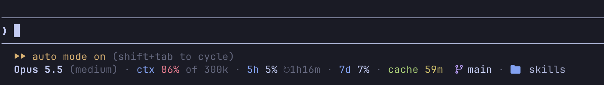

# pipboy-2000

Claude Code mod that adds a status row under the prompt.



## Features

- Model and effort level
- Context used. Counted against `CLAUDE_CODE_AUTO_COMPACT_WINDOW` when it's set, since that's where the session compacts. Orange from 50%, red from 75%.
- 5h and 7d usage with reset countdowns. Orange when usage runs ahead of the time gone in the window, red from 90%.
- Burn rate: `full in 40m` when the recent rate fills a window before it resets
- Prompt-cache countdown, from yellow to blue as it goes cold
- Git branch and project directory, flagged with `⚠` when the session is outside the project
- Drops detail to fit narrow terminals, down to just the model and context
- A Geiger counter: while Claude works, the dots between figures click green
- Toasts when context crosses 50% or 75%, when a window reaches 90%, and when a window resets

Labels keep their own colors. Values turn orange or red only when they need attention.

## Requirements

- Claude Code with mods (built and tested on 2.1.312)
- A Nerd Font for the branch and folder icons
- A Claude subscription for the 5h and 7d figures. Without one they're left out.

## Install

```sh
claude plugin marketplace add marcmodin/skills
claude plugin install pipboy-2000@marcmodin
```

To run it from a checkout, start Claude Code with `claude --plugin-dir mods/pipboy-2000`.

## Options

Set in `/config`, or under `pluginConfigs.pipboy-2000` in settings:

| Option | Values | Default |
| ------ | ------ | ------- |
| `place` | `below` (under the prompt), `above` (the band above the prompt) | `below` |
| `cacheTtl` | `5m`, `1h`. Mods can't read the cache's expiry, so the countdown assumes this TTL. | `1h` |
| `geiger` | `off`, `calm`, `berserk`: how often the dots click while Claude works | `berserk` |
